# Ruang Chat

Aplikasi chat Flutter untuk Android dan iOS dengan REST API + WebSocket Go, PostgreSQL, dan Docker Compose. Desain mengikuti konsep materi Pertemuan 5 dan 6: daftar percakapan, balon asimetris, input responsif, reply, media, status baca, dan tema adaptif. File presentasi hanya digunakan sebagai referensi materi.

## Screenshot aplikasi mobile

Screenshot diambil dari antarmuka aplikasi pada emulator Android. Akun, pesan, dan lampiran menggunakan data contoh di backend pengujian. Klik gambar untuk melihat ukuran penuh.

| Masuk | Daftar akun |
| :---: | :---: |
| <a href="docs/screenshots/01-login.png">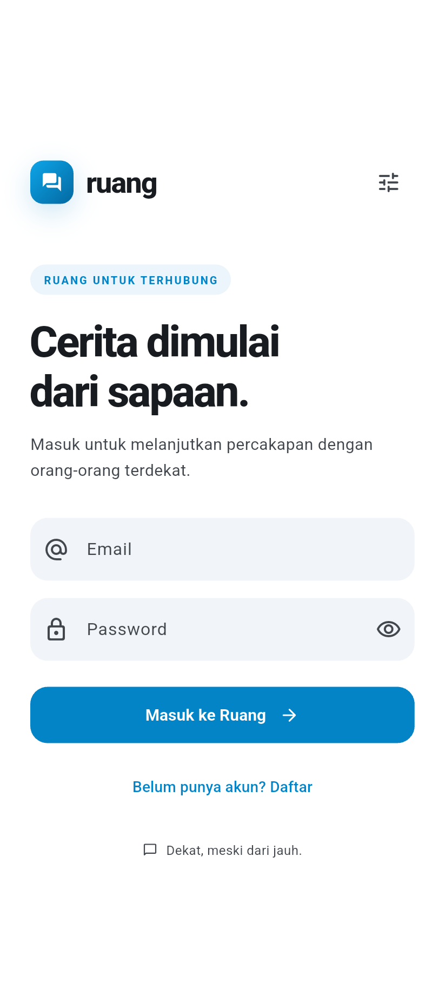</a> | <a href="docs/screenshots/02-register.png">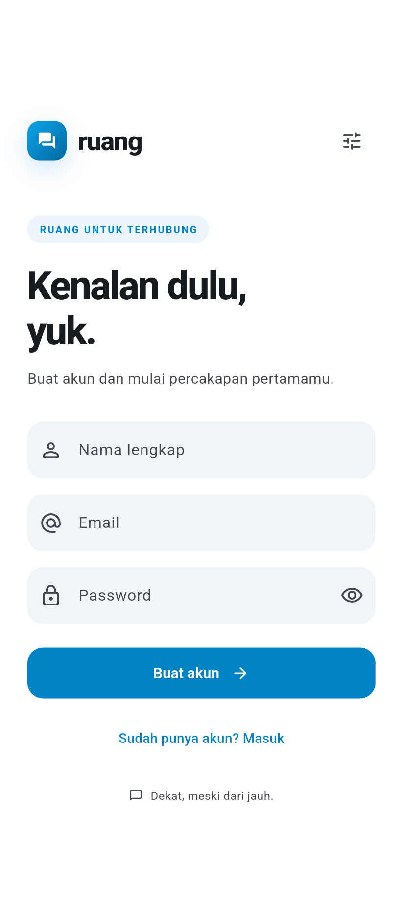</a> |
| Login menggunakan email dan password, dengan akses ke pendaftaran akun. | Form nama, email, dan password untuk membuat akun baru. |

| Pengaturan server | Daftar percakapan |
| :---: | :---: |
| <a href="docs/screenshots/03-server-settings.png">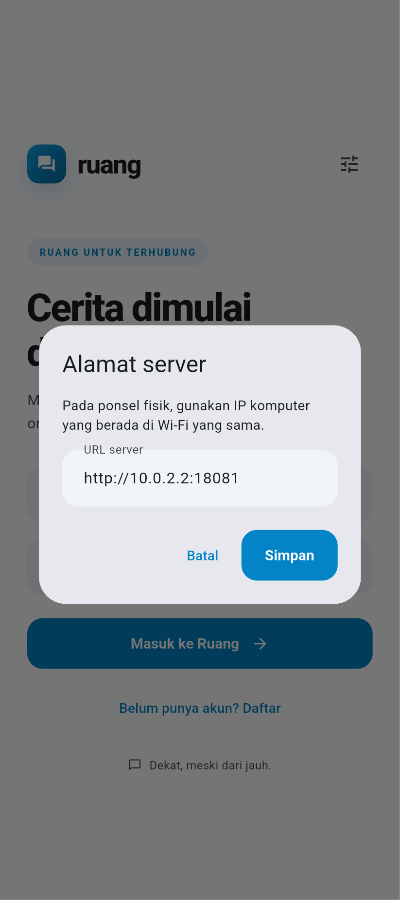</a> | <a href="docs/screenshots/04-conversations.png">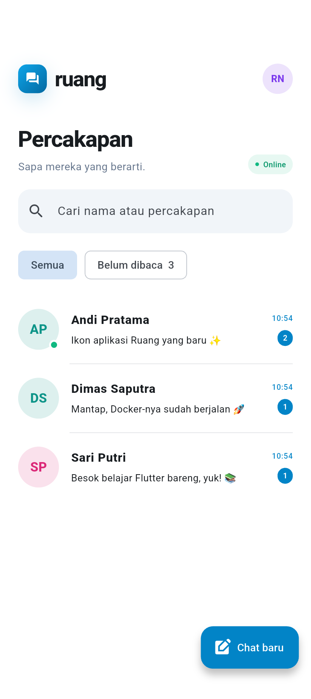</a> |
| Atur alamat API untuk emulator atau ponsel pada jaringan lokal. | Lihat kontak, ringkasan pesan, waktu terakhir, serta jumlah pesan belum dibaca. |

| Chat baru | Profil & preferensi |
| :---: | :---: |
| <a href="docs/screenshots/05-new-chat.png">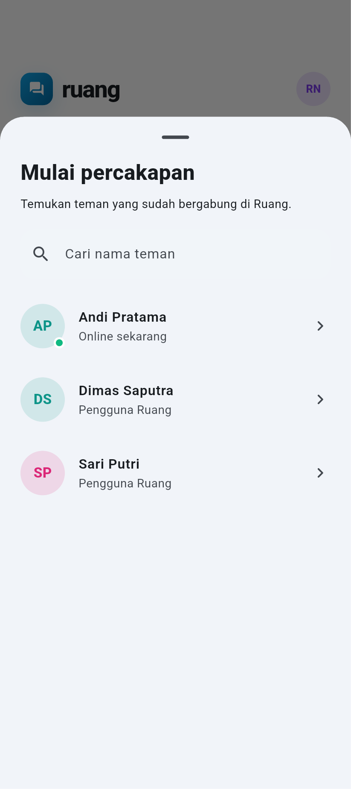</a> | <a href="docs/screenshots/06-profile.png">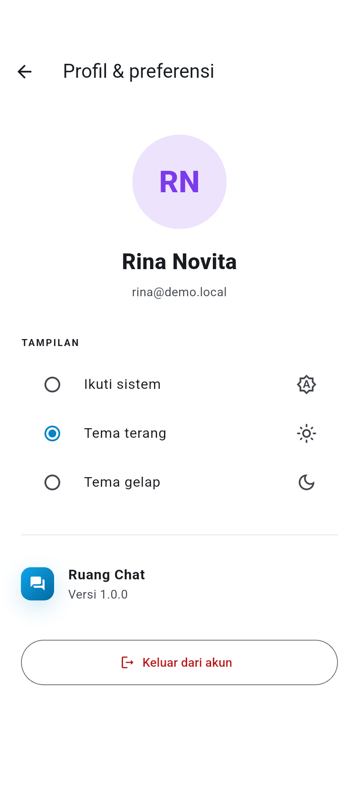</a> |
| Cari pengguna yang sudah terdaftar dan mulai percakapan pribadi. | Lihat profil sendiri, pilih tema sistem/terang/gelap, dan keluar dari akun. |

| Ruang chat | Tema gelap |
| :---: | :---: |
| <a href="docs/screenshots/07-chat.png">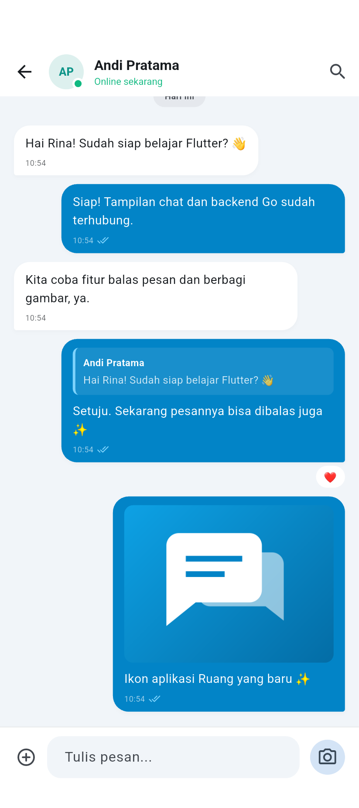</a> | <a href="docs/screenshots/08-chat-dark.png">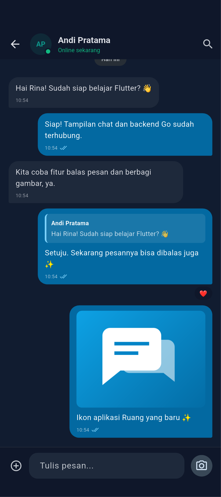</a> |
| Percakapan dengan teks, gambar, kutipan balasan, reaksi, dan status baca. | Tampilan percakapan yang menyesuaikan pilihan tema gelap. |

| Info kontak | Penampil gambar |
| :---: | :---: |
| <a href="docs/screenshots/09-contact.png">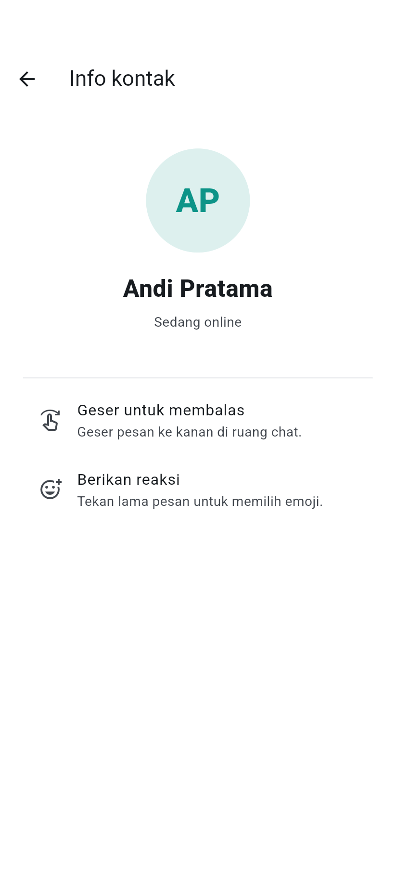</a> | <a href="docs/screenshots/10-image-viewer.png"></a> |
| Lihat identitas dan status kontak, beserta petunjuk balasan dan reaksi. | Buka gambar dari percakapan dalam tampilan penuh dengan dukungan zoom. |

| Menu lampiran | Reaksi pesan |
| :---: | :---: |
| <a href="docs/screenshots/11-attachments.png">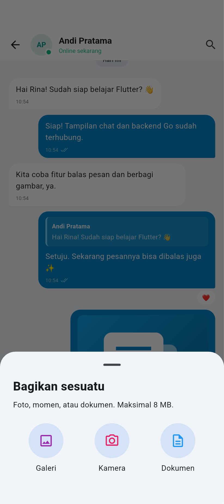</a> | <a href="docs/screenshots/12-reactions.png">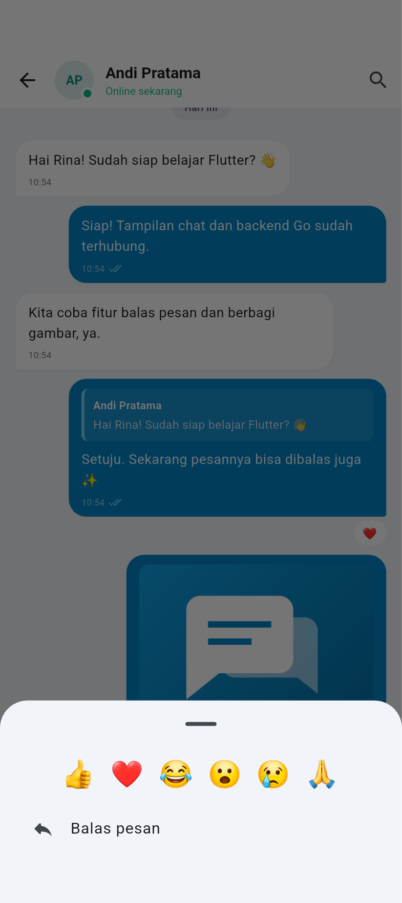</a> |
| Pilih galeri, kamera, atau dokumen untuk dibagikan ke percakapan. | Tekan lama pesan untuk memilih emoji reaksi atau membalas pesan. |

| Pratinjau balasan | Pencarian pesan |
| :---: | :---: |
| <a href="docs/screenshots/13-reply.png">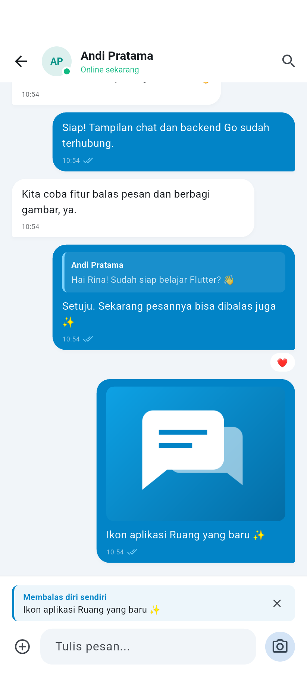</a> | <a href="docs/screenshots/14-search.png">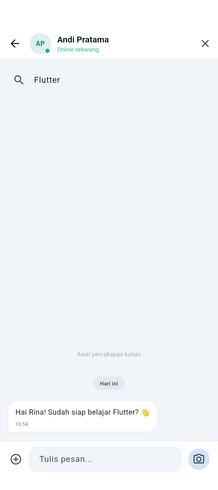</a> |
| Periksa kutipan pesan di atas kolom ketik sebelum mengirim balasan. | Cari kata kunci pada riwayat percakapan yang sudah dimuat. |

## Software yang perlu diinstal

Untuk menjalankan aplikasi Android beserta backend, siapkan **Git, Flutter SDK, Docker, dan Android Studio beserta Android SDK**. Versi acuan proyek adalah Flutter **3.47.5** dengan Dart **3.13.4**, serta Go **1.25+**. Batas Dart pada proyek adalah `^3.13.4`; gunakan Flutter 3.47.5 agar sama dengan konfigurasi CI.

| Software | Kapan diperlukan | Fungsi dan cara mendapatkan |
| --- | --- | --- |
| [Git](https://git-scm.com/downloads) | Untuk clone dan mengelola kode | Mengunduh repositori, membuat commit, serta melakukan pull/push ke GitHub. |
| [Flutter SDK](https://docs.flutter.dev/install) | Untuk menjalankan, mengembangkan, atau build aplikasi | Menyediakan perintah `flutter` beserta Dart SDK. Tambahkan folder `flutter/bin` ke `PATH`; versi acuan dapat diunduh dari [arsip Flutter](https://docs.flutter.dev/install/archive). |
| [Docker Desktop](https://docs.docker.com/get-started/get-docker/) | Untuk menjalankan backend dan database | Docker Desktop menyediakan Docker Engine, CLI, dan Compose. Pada Linux, alternatifnya Docker Engine dengan [plugin Compose](https://docs.docker.com/compose/install/). |
| [Android Studio dan Android SDK](https://docs.flutter.dev/platform-integration/android/setup) | Untuk target Android | Menyediakan SDK Manager, Android Emulator, dan tool build Android. Flutter SDK tetap perlu dipasang meskipun plugin Flutter di editor sudah terpasang. |
| JDK dari Android Studio | Untuk build Android | Flutter dapat memakai Java yang disertakan Android Studio. Lokasi dan versinya ditampilkan oleh `flutter doctor -v`. |
| [Xcode dan iOS Simulator](https://docs.flutter.dev/platform-integration/ios/setup) | Untuk target iOS, pada macOS | Menyediakan compiler, SDK iOS, simulator, dan pengaturan signing untuk perangkat fisik. |
| [CocoaPods](https://guides.cocoapods.org/using/getting-started.html) | Jika plugin iOS menggunakan CocoaPods | Mengelola dependency native iOS yang memakai Pods; ikuti hasil pemeriksaan Flutter untuk setup iOS. |

Dart SDK ikut terpasang bersama Flutter. PostgreSQL 17 serta toolchain Go untuk build backend disediakan oleh image Docker proyek. Package aplikasi dan backend diunduh melalui pengelola dependency pada langkah berikutnya.

### Menyiapkan Flutter dan Docker

1. Instal Flutter SDK sesuai sistem operasi, lalu tambahkan direktori `flutter/bin` ke `PATH` mengikuti [panduan instalasi Flutter](https://docs.flutter.dev/install).
2. Instal Docker Desktop, buka aplikasinya, dan tunggu sampai Docker Engine berjalan. Pada Linux dengan Docker Engine, jalankan layanan Docker dan pastikan plugin Compose tersedia.
3. Buka terminal baru agar perubahan `PATH` terbaca, kemudian periksa:

```bash
git --version
flutter --version
dart --version
docker --version
docker compose version
docker info
flutter doctor -v
```

`docker info` memastikan terminal dapat terhubung ke Engine. `flutter doctor -v` menunjukkan komponen pengembangan yang sudah siap atau masih perlu dilengkapi. Lengkapi komponen sesuai target: Android untuk APK, atau Xcode/iOS untuk aplikasi iPhone.

### Menyiapkan Android

1. Instal dan buka Android Studio.
2. Buka **SDK Manager** dari **More Actions** pada halaman awal, atau **Tools > SDK Manager** ketika proyek terbuka.
3. Pada **SDK Platforms**, instal Android SDK Platform sesuai kebutuhan Flutter/Gradle. Gradle dapat meminta versi tambahan ketika build pertama kali dijalankan.
4. Pada **SDK Tools**, pasang Android SDK Build-Tools, Command-line Tools, Platform-Tools, Android Emulator, CMake, dan NDK (Side by side). Lihat [panduan Android Flutter](https://docs.flutter.dev/platform-integration/android/setup) untuk konfigurasi sesuai sistem operasi.
5. Buka **Device Manager**, buat perangkat virtual, pilih system image yang sesuai arsitektur komputer, lalu nyalakan emulator. Untuk perangkat fisik, aktifkan Developer Options dan USB debugging, lalu sambungkan melalui USB.
6. Tinjau lisensi SDK dan periksa perangkat:

```bash
flutter doctor --android-licenses
flutter doctor -v
flutter devices
```

Selesaikan persetujuan lisensi yang diperlukan, lalu pastikan bagian Android toolchain siap dan emulator/perangkat muncul pada `flutter devices`.

### Menyiapkan iOS di macOS

Instal Xcode, buka untuk menyelesaikan setup awal dan meninjau lisensinya, lalu unduh runtime iOS Simulator. Siapkan CocoaPods bila dependency native memerlukannya. Ikuti [panduan setup iOS Flutter](https://docs.flutter.dev/platform-integration/ios/setup), kemudian periksa kembali dengan `flutter doctor -v` dan `flutter devices`. Untuk iPhone fisik, atur akun Apple dan signing melalui Xcode.

### Software tambahan sesuai kebutuhan

| Software | Kegunaan |
| --- | --- |
| [Go SDK 1.25+](https://go.dev/doc/install) | Menjalankan perintah Go di komputer, mengembangkan backend, serta menjalankan `scripts/test-backend.sh` dan `make test`. Untuk menjalankan backend melalui Docker, Go sudah tersedia di tahap build container. |
| Editor seperti VS Code dengan ekstensi Flutter/Dart, atau Android Studio dengan plugin Flutter | Menulis kode, menjalankan debugger, dan memakai bantuan editor. |
| Chrome | Menjalankan versi web menggunakan `flutter run -d chrome --web-port 3000`. |
| Bash dan Make | Menjalankan script `.sh` dan perintah singkat pada `Makefile`. Gunakan Bash yang kompatibel, misalnya melalui WSL pada Windows; perintah Flutter dan Docker juga dapat dijalankan langsung. |
| Python 3 dan librsvg (`rsvg-convert`) | Menghasilkan ulang ikon dari `mobile/branding/ruang.svg` dengan `python3 scripts/generate-icons.py`. Ikon hasil render sudah ada di repositori. |

Jika memasang Go untuk pengembangan atau tes, pastikan `go version` dapat dijalankan dari terminal.

## Mengunduh proyek dan memasang dependency

Clone repositori private menggunakan akun GitHub yang memiliki akses:

```bash
git clone https://github.com/Shofyan/chat-app.git
cd chat-app
```

Jika kode sudah ada di komputer, buka terminal pada folder `chat-app`. Seluruh perintah berikut diasumsikan dijalankan dari folder tersebut, kecuali ada langkah `cd` yang disebutkan.

### Dependency Flutter

```bash
(cd mobile && flutter pub get)
```

Perintah ini mengunduh package yang tercatat di `mobile/pubspec.yaml`; `mobile/pubspec.lock` menyimpan versi yang digunakan aplikasi.

| Package langsung | Fungsi |
| --- | --- |
| `flutter` dan `cupertino_icons` | Framework UI dan kumpulan ikon bergaya iOS. |
| `http` | Mengakses REST API Go. |
| `web_socket_channel` | Menerima event chat real-time dan mengirim indikator mengetik. |
| `flutter_secure_storage` | Menyimpan token sesi pada perangkat. |
| `image_picker` | Memilih foto dari galeri atau kamera. |
| `file_picker` | Memilih dan menyimpan lampiran. |
| `shared_preferences` | Menyimpan pilihan tema dan alamat server. |
| `uuid` | Membuat `client_id` unik untuk pengiriman pesan. |
| `flutter_test`, `integration_test`, dan `flutter_lints` | Tes widget, tes perangkat, dan pemeriksaan kualitas kode saat pengembangan. |

### Dependency backend dan database

Saat menjalankan `docker compose up -d --build --wait`, Docker mengunduh image PostgreSQL `17-alpine`, image build Go `1.25-alpine`, dan image runtime Alpine `3.22`. Tahap build menjalankan `go mod download` untuk memasang library backend:

| Library langsung | Fungsi |
| --- | --- |
| `github.com/coder/websocket` | Koneksi dan event WebSocket. |
| `github.com/jackc/pgx/v5` | Driver koneksi PostgreSQL. |
| `golang.org/x/crypto` | Hash password menggunakan bcrypt. |

Versi library dan dependency turunannya tercatat pada `backend/go.mod` dan `backend/go.sum`. Jika mengembangkan backend memakai Go di komputer, unduh dependency dengan:

```bash
(cd backend && go mod download)
```

Database untuk aplikasi dibuat dan dikelola oleh service `db` pada Compose. Instalasi awal memerlukan koneksi internet untuk mengunduh SDK, package, image Docker, serta dependency build Android/iOS.

## Menjalankan backend

Pastikan Docker Engine berjalan dan `docker compose version` berhasil. Flutter diperlukan untuk aplikasi mobile; Go di komputer diperlukan bila menjalankan perintah pengembangan atau tes backend secara lokal.

```bash
# Dari folder chat-app. .env opsional, nilai lokal sudah tersedia.
cp .env.example .env
docker compose up -d --build --wait
curl http://localhost:8080/health
```

API tersedia di port 8080. PostgreSQL hanya diakses dari jaringan Docker dan disimpan pada volume `ruang-chat_postgres_data`. Skema dibuat otomatis saat backend dimulai. `docker compose down` menghentikan layanan tanpa menghapus data. Mengubah password database di `.env` tidak mengubah password pada volume yang sudah diinisialisasi.

## Menjalankan aplikasi mobile

```bash
cd mobile
flutter pub get
flutter devices
flutter run
```

Alamat default Android emulator adalah `http://10.0.2.2:8080`; iOS Simulator dan web memakai `http://localhost:8080`. Pada ponsel fisik, sambungkan ke Wi-Fi yang sama dengan komputer dan gunakan IP LAN komputer:

```bash
flutter run --dart-define=API_BASE_URL=http://192.168.1.10:8080
```

Alamat juga dapat diubah melalui ikon pengaturan di halaman masuk dan tersimpan di perangkat. Alamat tersimpan mengungguli nilai build berikutnya; ubah kembali melalui halaman masuk bila berpindah server. Masukkan URL dasar tanpa `/api/v1`. Untuk Android melalui USB, alternatifnya `adb reverse tcp:8080 tcp:8080` lalu gunakan `http://localhost:8080` di pengaturan aplikasi.

Build APK pengujian:

```bash
cd mobile
flutter build apk --debug
# Dari root repo: mobile/build/app/outputs/flutter-apk/app-debug.apk
```

Build iOS memerlukan Xcode dan signing Anda untuk perangkat fisik. Izin kamera, galeri, jaringan lokal, dan Keychain sudah disiapkan. Konfigurasi HTTP Android/iOS ditujukan untuk server lokal; untuk distribusi gunakan HTTPS/WSS, hapus izin cleartext/ATS arbitrary loads, dan atur signing rilis. Docker menjalankan backend dan database; aplikasi mobile berjalan di emulator atau perangkat.

## Mencoba chat dua arah

Dengan `SEED_DEMO=true` (default lokal), akun dan contoh percakapan dibuat sekali:

| Nama | Email | Password |
| --- | --- | --- |
| Rina Novita | `rina@demo.local` | `ChatDemo123!` |
| Andi Pratama | `andi@demo.local` | `ChatDemo123!` |
| Sari Putri | `sari@demo.local` | `ChatDemo123!` |

1. Masuk sebagai Rina di emulator.
2. Masuk sebagai Andi pada perangkat lain atau versi web.
3. Buka percakapan Rina–Andi. Kirim pesan, geser pesan ke kanan untuk balasan, tekan lama untuk reaksi, dan unggah foto/dokumen.
4. Status online, mengetik, jumlah belum dibaca, dan centang baca mengikuti aktivitas pengguna sebenarnya. Tidak ada bot balasan otomatis.

Anda juga dapat mendaftarkan akun baru lalu memilih **Chat baru**. Pencarian kontak memakai nama, sehingga email tidak ditampilkan kepada pengguna lain. Matikan `SEED_DEMO` untuk database baru tanpa akun contoh; perubahan ini tidak menghapus data contoh yang sudah ada.

Versi web untuk pengujian tambahan:

```bash
cd mobile
flutter run -d chrome --web-port 3000
```

Origin web lokal port 3000 sudah diizinkan. Untuk origin lain, tambahkan URL lengkapnya ke `ALLOWED_ORIGINS` lalu recreate container API. Penyimpanan sesi web memerlukan localhost atau HTTPS.

## Fitur

- Registrasi, login, sesi 30 hari di secure storage, logout yang mencabut sesi server.
- Chat pribadi dua pengguna, pencarian kontak dan daftar chat, filter belum dibaca.
- WebSocket, reconnect otomatis, pengambilan ulang riwayat setelah tersambung.
- Riwayat persisten, pagination 50 pesan, waktu lokal, pemisah hari, pengiriman ulang idempoten.
- Balas lewat swipe atau tekan lama, kutipan dan pratinjau balasan.
- Foto galeri/kamera, preview dan zoom, unggah serta simpan PDF/TXT. Batas 8 MB; JPEG/PNG/GIF/WebP juga didukung.
- Reaksi emoji tersimpan, indikator mengetik, status online, centang baca, auto-scroll.
- Profil, transisi avatar Hero, tema sistem/terang/gelap yang tersimpan.
- Validasi input, pembatasan percobaan autentikasi, otorisasi anggota, unduhan lampiran dengan autentikasi.

Pencarian ruang chat menyaring riwayat yang sudah dimuat; gunakan **Muat pesan sebelumnya** untuk memperluasnya. Pesan dikirim ketika API tersedia dan draft tetap ada bila pengiriman gagal. Belum tersedia antrean offline, push notification, pesan suara, panggilan, grup, enkripsi end-to-end, atau pemulihan password. Tombol kosong di input membuka media, lalu beranimasi menjadi kirim ketika ada konten. Pesan ditandai dibaca saat ruang chat aktif dan daftar berada dekat pesan terbaru.

## Struktur

```text
backend/
  cmd/server/            HTTP, koneksi DB, graceful shutdown
  internal/chat/        Autentikasi, handler, skema, media, WebSocket, tes
  Dockerfile            Build multi-stage, proses non-root
mobile/
  lib/core/             Model, HTTP, sesi, reconnect WebSocket
  lib/screens/          Login, percakapan, chat, profil
  lib/widgets/          Tema, avatar, pesan, lampiran
docs/api.md             Kontrak REST dan event WebSocket
docs/openapi.json       Kontrak HTTP yang dapat diimpor ke Postman
docs/screenshots/       Screenshot setiap halaman dan panel aplikasi mobile
scripts/test-backend.sh Tes dengan PostgreSQL sementara terisolasi
scripts/capture-screenshots.sh Mengambil ulang screenshot untuk README
compose.yaml            API + PostgreSQL dengan healthcheck dan volume
```

REST menyimpan perubahan dahulu lalu WebSocket menyebarkan event kepada anggota. Token disimpan sebagai SHA-256 di server, password memakai bcrypt. Bytes lampiran disimpan dalam PostgreSQL sehingga backup database mencakup media. Skema awal idempoten; perubahan skema berikutnya memerlukan migrasi berversi. Hub WebSocket untuk satu instance API; replica tambahan memerlukan broker event.

## Pemeriksaan

```bash
make test
(cd backend && go vet ./...)
(cd mobile && flutter build web)
(cd mobile && flutter build apk --debug)
```

Untuk tes Android end-to-end, nyalakan emulator lalu jalankan dari root:

```bash
./scripts/test-mobile.sh emulator-5554
```

Script ini memakai backend dan volume sementara terpisah pada port 18081, lalu menghapusnya setelah tes. Screenshot tema terang/gelap disimpan di `.artifacts/screenshots`. Setelah tes, pasang kembali aplikasi normal dengan `cd mobile && flutter run -d emulator-5554` karena APK tes memakai entrypoint dan alamat server pengujian.

Untuk mengambil ulang seluruh screenshot pada README, nyalakan emulator Android dan jalankan:

```bash
./scripts/capture-screenshots.sh emulator-5554
```

Hasil PNG disimpan pada `docs/screenshots/` dan ikut dikelola oleh Git. Script memakai halaman aplikasi asli, membuat data contoh di backend sementara, dan memeriksa navigasi setiap halaman saat pengambilan gambar. Pengaturan serta sesi login yang tersimpan di perangkat tidak digunakan oleh skenario screenshot. Setelah selesai, jalankan kembali aplikasi utama:

```bash
(cd mobile && flutter run -d emulator-5554 --target lib/main.dart)
```

`scripts/test-backend.sh` membuat database sementara pada port acak localhost dan menghapus containernya setelah tes. Database aplikasi tidak diubah. Tes mencakup autentikasi, idempotensi, WebSocket, baca, reaksi, lampiran, penolakan akses pihak ketiga, kutipan lintas percakapan, serta cursor pagination. Tanpa `TEST_DATABASE_URL`, `go test ./...` melewati tes integrasi. CI menjalankan tes Go dengan race detector dan pemeriksaan Flutter.

Referensi: [Flutter deployment](https://docs.flutter.dev/deployment/android), [WebSocket Go](https://github.com/coder/websocket), [pgx](https://github.com/jackc/pgx), [file_picker](https://pub.dev/packages/file_picker), [secure storage](https://pub.dev/packages/flutter_secure_storage).
